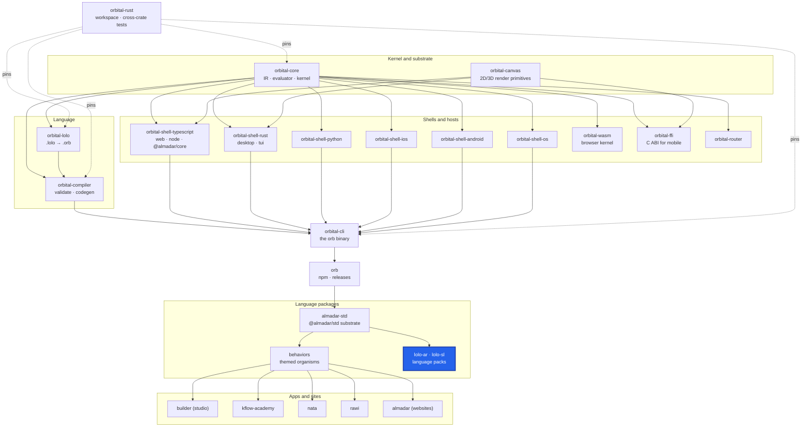

<div align="center">

# @almadar/lolo-sl

**The Slovenian (Slovenščina) language pack for `.lolo` and `.orb`: write and read Almadar programs in Slovenian.**

[](https://github.com/almadar-io/lolo-sl/actions/workflows/ci.yml)
[](https://github.com/almadar-io/lolo-sl/actions/workflows/publish.yml)
[](https://www.npmjs.com/package/@almadar/lolo-sl)
[](./LICENSE)

</div>

With this pack installed, `orb` reads and writes programs whose keywords, effects, operators and `.orb` keys are spelled in Slovenian. English is built into `orb`; every other language is a pack like this one. The package is one file, `vocabulary.json`.

## Where this fits



| Upstream (this repo depends on) | Downstream (depends on this repo) |
|---|---|
| [orb](https://github.com/almadar-io/orb): the binary that loads and enforces the pack | [almadar-std](https://github.com/almadar-io/almadar-std): lists both packs as dev dependencies |
| `@almadar/core`: owns the language data (`orbLanguage.version`) the pack's `language` range is checked against | |

## Quick start

```bash
orb language install @almadar/lolo-sl
```

`orb setup` installs the packs too. Node 22 or newer.

## What's inside

| File | What it is |
|---|---|
| `vocabulary.json` | Maps each English word to its Slovenian spelling, section by section: `keywords`, `shapes`, `tags`, `categories`, `capabilities`, `annotations`, `sigils`, `effects`, `types`, `units`, `literals`, `reservedEvents`, `orb`, `operators`, plus `meta: { code, name, rtl }` (here `{ "code": "sl", "name": "Slovenian", "rtl": false }`) |
| `scripts/check.mjs` | The shape check run by `pnpm test` and by CI |

### Pack contract

A language pack is any npm package whose `package.json` declares:

```json
"orbVocabulary": { "language": "^1", "vocabulary": "vocabulary.json" }
```

`language` is a range over the language-data version `@almadar/core` publishes as `orbLanguage.version`; the pack is usable only while the installed language satisfies it. `orb` refuses a pack that makes a program ambiguous: two English words with one spelling, or a first-word spelling another installed language already uses. A word the pack does not translate stays legal in English.

## Development

```bash
node scripts/check.mjs   # also pnpm test
pnpm exec eslint --no-warn-ignored --max-warnings 0 <files you touched>
```

Coverage against English (missing words, collisions, operator parity) is checked in the monorepo's i18n gate and by `orb` when it loads the pack, not here. Open gaps are tracked in [`Almadar_Gaps.md`](./Almadar_Gaps.md). Work on `main` only; releases go through the monorepo cascade and a `v*` tag.

## Docs

[Orb documentation](https://orb.almadar.io/docs): the language, the `orb` CLI and how the pieces fit

## License

Business Source License 1.1 (see [LICENSE](./LICENSE)). Converts to Apache 2.0 on 2030-02-01.
